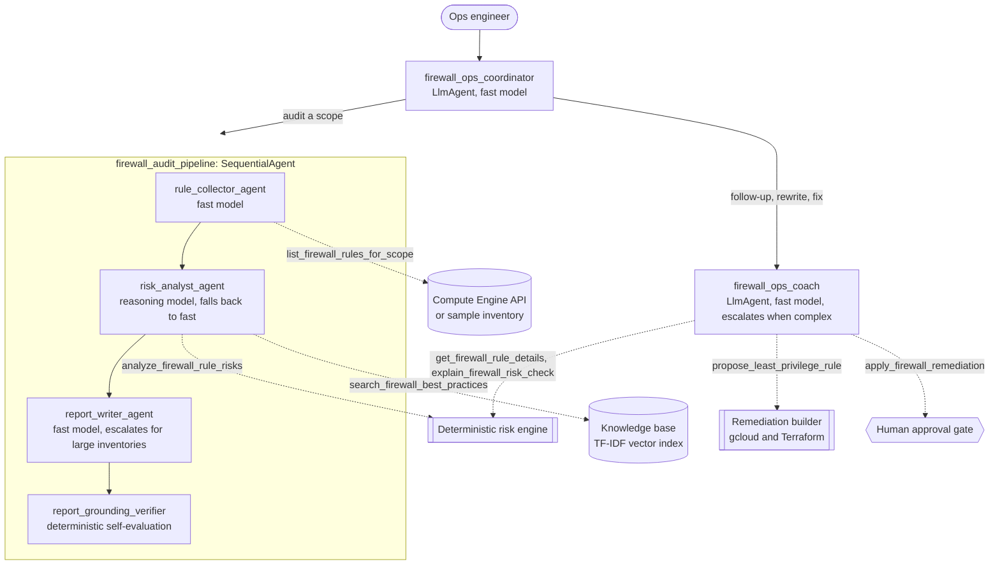

# GCP Firewall Ops Agent

A multi-agent system, built with Google's **Agent Development Kit (ADK 2.15)** on
**Gemini Enterprise Agent Platform**, that audits Google Cloud firewall rules at any level of the resource
hierarchy (organization, folder or project), produces a prioritized and **verified** risk report, and coaches
operations engineers to write least-privilege rules. Any change goes through **human approval**.

> Capstone project for a 5-day AI agents course. All sample data is fictional.

## The problem

Firewall rules pile up across organization policies, folder policies and hundreds of project VPC rules. Teams
miss the interactions between levels. For example, an organization-level `allow` that a project `deny` can never
override, or a project rule that looks open but is actually blocked upstream. Rules get opened "temporarily" and
are never closed. Auditing this by hand is slow and error-prone, and generic chatbots make up rules they cannot see.

## The solution

| Capability | How it works |
| --- | --- |
| **Read** rules at org / folder / project level | Compute Engine API (`firewalls.list`, `firewallPolicies.list`, `networks.getEffectiveFirewalls`): VPC firewall rules, hierarchical (org/folder) policies and network firewall policies, or a bundled fictional org for demos |
| **Detect** risks deterministically | 13 checks (internet-exposed SSH/RDP/databases, any-any rules, wide port ranges, missing logging, default-network rules, org/folder overrides, shadowed rules, lateral movement), hierarchy-aware precedence, 0-100 posture score |
| **Explain and prioritize** | A reasoning-model analyst grounded in a firewall best-practice knowledge base (vector retrieval) |
| **Verify** | A deterministic grounding verifier checks the LLM's report for invented rule names, missing high risks and score drift |
| **Coach** | Explains why a rule is risky, which higher-precedence rule actually decides the traffic, and drafts least-privilege replacements with `gcloud` + Terraform |
| **Remediate safely** | Changes pause for explicit human approval and are staged (dry run) unless live remediation is enabled; live changes also need a change ticket |

## Architecture



**App-level plugins** (apply to every agent): AgentOps intent/outcome logging, security guardrails (user-input
redaction, prompt injection, secret exfiltration, destructive intent, tool budget, scope allowlist, no
exposure-widening fixes), reflect-and-retry on guided tool errors, and background PII-scrubbed memory ingestion. **Context management:**
event compaction (sliding window + token threshold, summarized by a lite model), context caching, compact tool
outputs with full data kept in session state, and `include_contents="none"` for the report writer.

| Model role | Default (long-term GA, Nov 2026) | Used by |
| --- | --- | --- |
| Fast | `gemini-3.8-flash` | coordinator, collector, report writer, coach |
| Reasoning | `gemini-4-argon` | risk analyst; the coach escalates here for complex questions, the writer for large inventories |
| Lite | `gemini-3.5-flash-lite` | history compaction summaries |

Gemini 2.5 models were retired on 2026-10-20; override any model with `FAST_MODEL`, `REASONING_MODEL` or `LITE_MODEL`.

See [docs/ARCHITECTURE.md](docs/ARCHITECTURE.md) for data flow and design decisions.

## Quickstart

### 1. Run the tests (no cloud access needed)

```bash
python3 -m venv .venv && source .venv/bin/activate
pip install -r requirements-dev.txt
make test          # 136 offline tests (unit, end-to-end with a scripted model, ADK AgentEvaluator, golden); 1 live test is opt-in
make eval-golden   # deterministic risk-engine evaluation: precision / recall / grade accuracy
```

### 2. Chat with the agent (Gemini on Agent Platform, sample firewall data)

```bash
gcloud auth application-default login
cp .env.example firewall_ops_agent/.env   # set GOOGLE_CLOUD_PROJECT; keep FIREWALL_DATA_MODE=sample
make web                                  # ADK dev UI on port 8080 (Cloud Shell: Web Preview > port 8080)
# or: make playground                     # the same agent through the Agents CLI playground
# or: make chat                           # terminal chat with persistent sessions, memory and approvals
```

Try:

1. `Audit project prod-payments-app including inherited policies`
2. `Why is allow-legacy-telnet marked as mitigated?`
3. `Draft a least-privilege replacement for default-allow-ssh`
4. `Stage that fix for approval` (the agent pauses until you approve)
5. `Audit organization 100000000001`

### 3. Audit real rules (for example in a sandbox project via Cloud Shell)

Set `FIREWALL_DATA_MODE=live` in `firewall_ops_agent/.env` and audit your own project. The agent only needs
read access (`roles/compute.networkViewer`; `roles/compute.orgFirewallPolicyUser` for org/folder policies).
Project audits include VPC firewall rules and network firewall policies on every VPC network; with
`include_inherited_policies` they also include the organization and folder policies that apply first. If a
folder or organization policy cannot be attributed (missing permission), the audit continues and reports a
warning.

Live changes are deliberately hard to make. They require `ENABLE_LIVE_REMEDIATION=true`, the narrow
Terraform-managed custom role (it can only patch existing VPC firewall rules), explicit human approval **and**
a change ticket in the approval. Hierarchical and network policy rules are never changed by the agent; their
fixes are staged as change requests for the owning team.

### 4. Provision and deploy

```bash
cp infra/terraform/terraform.tfvars.example infra/terraform/terraform.tfvars   # edit
make infra-init infra-apply      # APIs, least-privilege service account, IAM, log-based guardrail metric
make deploy PROJECT=your-project # adk deploy agent_engine ... --service_account=... --otel_to_cloud
```

On Agent Runtime, ADK automatically uses managed **Agent Platform Sessions** and **Memory Bank** (regional:
`AGENT_ENGINE_LOCATION`, default `us-central1`).

### 5. Use the Agents CLI

The repo includes `agents-cli-manifest.yaml` (generated with
`agents-cli scaffold enhance --from-adk-project --agent-directory firewall_ops_agent`), so the
[Agents CLI](https://google.github.io/agents-cli/) recognizes the project:

| Task | Command | Make target |
| --- | --- | --- |
| Install the CLI skills into your coding agent | `uvx google-agents-cli setup` | `make agents-setup` |
| Show how the CLI sees this project | `agents-cli info` | `make agents-info` |
| Local playground | `agents-cli playground` | `make playground` |
| One-shot prompt | `agents-cli run "Audit project prod-payments-app"` | `make agents-run PROMPT="..."` |
| Code-quality checks | `agents-cli lint` | `make agents-lint` |
| Evaluate with LLM-graded metrics | `agents-cli eval run --dataset <cases.json>` | |

The manifest was created without deployment scaffolding, so the primary deploy path is `make deploy`
(`adk deploy agent_engine`). To deploy with the Agents CLI instead, first add its deployment files with
`agents-cli scaffold enhance --deployment-target agent_runtime --dry-run` (review, then run without `--dry-run`),
then `agents-cli deploy --project <id> --region us-central1`.

Set `AGENTS_CLI_TELEMETRY=0` to opt out of CLI usage telemetry (the make targets do this).

## Evaluation and quality

| Layer | What it checks | Where |
| --- | --- | --- |
| Golden dataset | Exact findings, severities and grades for 7 scopes (precision = recall = 1.0 required) | `eval/golden/`, `eval/run_golden_eval.py` |
| ADK AgentEvaluator | Tool trajectories (in order) and response match for 3 journeys incl. multi-turn and guardrail refusal | `eval/agent_evalsets/` |
| End-to-end (offline) | Full Runner with scripted model: delegation, pipeline, verifier, HITL approve/reject, persistence, memory redaction | `tests/test_end_to_end_offline.py` |
| Unit | Engine, tools, guardrails, redaction, routing, memory, wiring, secret scanning | `tests/` |
| CI | Lint, tests, golden eval, Terraform fmt/validate; optional live eval with keyless Workload Identity Federation | `.github/workflows/ci.yml` |

## Security and privacy

- No API keys or credentials in code. Application Default Credentials on Google Cloud; an optional developer
  key is read from **Secret Manager** (`GOOGLE_API_KEY_SECRET`). `.env` is git-ignored and a test scans the repo for secrets.
- Least-privilege service account managed by Terraform; write access is opt-in and limited to a custom role
  that can only patch existing VPC firewall rules.
- Guardrails block prompt injection, secret exfiltration and destructive requests before any model call, without
  refusing everyday firewall questions (for example "which rules allow all traffic from the internet?").
- Where personal data is removed:
  - **User messages**: secrets, emails, phone numbers and card numbers are redacted *before* the message is stored
    in the session or sent to a model. IP addresses, CIDRs and service accounts are kept because answers need them.
  - **Logs**: every JSON log field is redacted (public host IPs are masked too).
  - **Memories**: events are redacted before long-term storage (regex always; Cloud DLP optional).
  - **Traces**: raw prompts and responses are kept out of spans by default
    (`ADK_CAPTURE_MESSAGE_CONTENT_IN_SPANS=false`).
  - **Model output**: credentials are scrubbed from responses.
- Every firewall change requires explicit human approval and is recorded with a change-request ID.

## Known limitations

- **Self-approval:** the person chatting with the agent is also the approver. Use the change-ticket requirement
  and your normal change review for separation of duties; a production rollout should route approvals to a
  different person or group.
- **Rule names:** rule names are assumed to be unique within one audited scope. Hierarchical policy rules without
  a name are identified as `<policy>/priority-<n>`.
- **Effective-firewall view:** findings are computed from rule definitions and the default enforcement order
  (network firewall policies after VPC rules). Custom enforcement orders and per-VM effective firewalls are not
  modeled.
- **Live model calls** are covered by the opt-in live evaluation (`make eval-live`), not by the offline CI suite.

## Course concepts to code

Each rubric criterion and course concept is mapped to the exact files in
[docs/RUBRIC_EVIDENCE.md](docs/RUBRIC_EVIDENCE.md). For a guided walkthrough of the codebase, see
[docs/LEARNING_GUIDE.md](docs/LEARNING_GUIDE.md).

## Repository layout

```text
firewall_ops_agent/          ADK agent package (adk web / adk run / adk deploy discover agent.app)
  agent.py                   coordinator, App, plugins, compaction, context caching
  sub_agents/                audit pipeline (SequentialAgent), coach, grounding verifier (custom BaseAgent)
  tools/                     function tools with docstrings, schemas and guided errors
  core/                      deterministic engine: data sources, risk checks, knowledge base, remediation, grounding
  guardrails/                input/tool/output guardrails, reflect-and-retry plugin
  memory/                    persistent sessions, PII-scrubbing memory, background ingestion
  observability/             JSON logging, OpenTelemetry tracing, redaction, AgentOps plugin
  config.py, routing.py      settings, model routing table, dynamic escalation, Secret Manager
  prompts.py                 system instructions
  data/                      fictional sample inventory, knowledge base
eval/                        golden dataset + ADK eval set and criteria
tests/                       offline test suite (no cloud access needed)
infra/terraform/             infrastructure as code
scripts/chat_cli.py          terminal chat with persistence, memory and approvals
```

## License

Apache 2.0. See [LICENSE](LICENSE). This is a learning project and is not an officially supported Google product.
