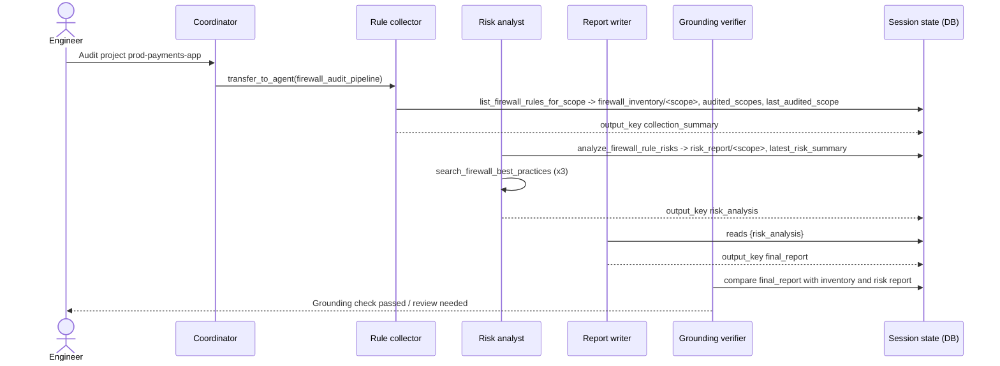
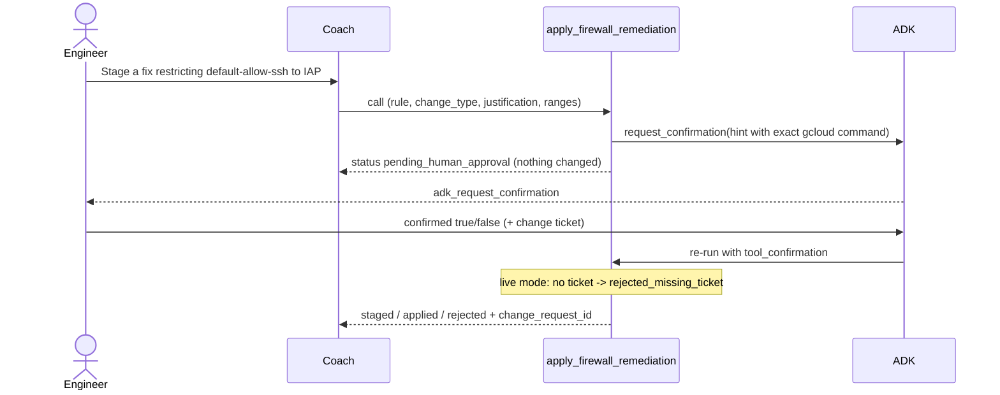

# Architecture

## Components

| Layer | Component | Responsibility |
| --- | --- | --- |
| Entry | `firewall_ops_coordinator` (LlmAgent) | Understands intent and delegates with `transfer_to_agent`. Has no tools of its own. |
| Pipeline | `firewall_audit_pipeline` (SequentialAgent) | Runs four steps in a fixed order for every audit. |
| | `rule_collector_agent` | Extracts the scope from the conversation and calls `list_firewall_rules_for_scope`. |
| | `risk_analyst_agent` | Calls the deterministic engine, retrieves best practices and writes a prioritized analysis. |
| | `report_writer_agent` | Formats the final Markdown report from `{risk_analysis}` only (`include_contents="none"`). |
| | `report_grounding_verifier` (custom BaseAgent) | Deterministically verifies the report against inventory and engine output. |
| Coaching | `firewall_ops_coach` (LlmAgent) | Rule explanations, hierarchy diagnosis, least-privilege drafts, approval-gated remediation, memory recall. |
| Core | `core/` | Pure Python: data sources, normalization, network math, risk engine, knowledge base, remediation builder, grounding. |
| Cross-cutting | `App` plugins | Observability, user-input redaction and guardrails, reflect-and-retry, background memory ingestion. |

## Audit sequence

## Human approval sequence

## Design decisions

1. **Deterministic detection, LLM explanation.** Severity and posture come from code so results are auditable,
   reproducible and testable against a golden dataset. The LLM prioritizes, explains and coaches.
2. **Hierarchy-aware precedence.** Rules are ordered by (level, priority, deny-first), with the levels organization
   policy, folder policy, project VPC rules, then network firewall policies (Google Cloud's default enforcement
   order). This finds shadowed denies, org/folder overrides (FW-011) and exposures that are actually blocked
   upstream (marked "(Mitigated)").
3. **State over context.** Full inventories and reports live in session state; tools return compact views. The
   report writer sees only the analysis. Compaction summarizes older turns.
4. **One state key per scope, lookups within one scope.** Each audited scope is stored under its own key
   (`firewall_inventory/<scope>`), so a new audit writes a small state delta, and rule lookups and shadowing are
   computed inside exactly one scope. A rule name that exists in several audited scopes returns an
   `ambiguous_rule_name` guided error until the model passes `scope_id`.
5. **Async tools.** Tools that call Google Cloud are `async` and run the blocking Compute Engine client in a worker
   thread (`asyncio.to_thread`), so one slow API call never stalls other sessions on the event loop.
6. **SequentialAgent in ADK 2.x.** `SequentialAgent` is deprecated in favor of `Workflow`, but a `Workflow` cannot
   yet be an `LlmAgent` sub-agent, which is how the coordinator delegates. The deprecation warning is silenced
   deliberately; migrating is a drop-in change once ADK supports it.
7. **Defense in depth for changes.** Exposure-widening ranges are rejected by schema and by the guardrail plugin,
   every change needs human approval, sample mode only stages changes, and live patches need
   `ENABLE_LIVE_REMEDIATION=true`, the opt-in Terraform custom role (patch existing VPC rules only) and a change
   ticket in the approval. Org/folder and network policy rules are never auto-patched.
8. **Privacy by construction.** User messages are redacted before they reach the session or a model; memory
   ingestion scrubs events itself, so PII is removed even when the hosting platform injects its own memory
   service; trace spans exclude raw prompts unless an operator opts in.
9. **Narrow guardrails.** Input checks target clear attacks (overriding the agent's instructions, asking for
   credentials, commanding a mass opening or shutdown of the firewall) and allow everyday firewall phrasing
   such as "which rules allow all traffic from the internet?" or "delete all unused rules".
10. **Two routing callbacks.** The coach escalates to the reasoning model for complex questions; the report writer
    escalates only for large inventories, because the wording of a question does not change its job.
11. **Default sampling settings.** Agents keep the default temperature, as Google recommends for Gemini 3+ models
   (lower values can cause looping). Repeatable results come from the deterministic engine and the verifier.

## Session state keys

| Key | Written by | Purpose |
| --- | --- | --- |
| `firewall_inventory/<scope>` | `list_firewall_rules_for_scope` (and on-demand loads) | Normalized rules of one scope, e.g. `firewall_inventory/project/prod-payments-app+inherited`. |
| `audited_scopes` | inventory tools | Scope keys audited in this session, most recent last. |
| `last_audited_scope` | inventory tools | Default scope for analysis and coaching. |
| `risk_report/<scope>`, `latest_risk_summary` | `analyze_firewall_rule_risks` | Full report of one scope and a compact summary injected into instructions. |
| `collection_summary`, `risk_analysis`, `final_report` | pipeline agents (`output_key`) | Step-to-step hand-off. |
| `grounding_verification` | `report_grounding_verifier` | Self-evaluation verdict. |
| `remediation_proposals`, `approved_change_requests` | remediation tools | Drafts and the approval audit trail. |

## Deployment topology

- **Local:** `adk web` / `scripts/chat_cli.py`, SQLite sessions and memory, sample or live data.
- **Agent Runtime (Agent Engine):** `adk deploy agent_engine --service_account=... --otel_to_cloud`; managed
  Agent Platform Sessions and Memory Bank; JSON logs to Cloud Logging; traces to Cloud Trace.
- **IAM:** dedicated service account from `infra/terraform` with read-only firewall roles by default; optional
  custom role that can only patch existing VPC firewall rules.
- **Regions:** Gemini models use the `global` endpoint (`GOOGLE_CLOUD_LOCATION`); Agent Runtime sessions and
  Memory Bank are regional (`AGENT_ENGINE_LOCATION`, default `us-central1`).
